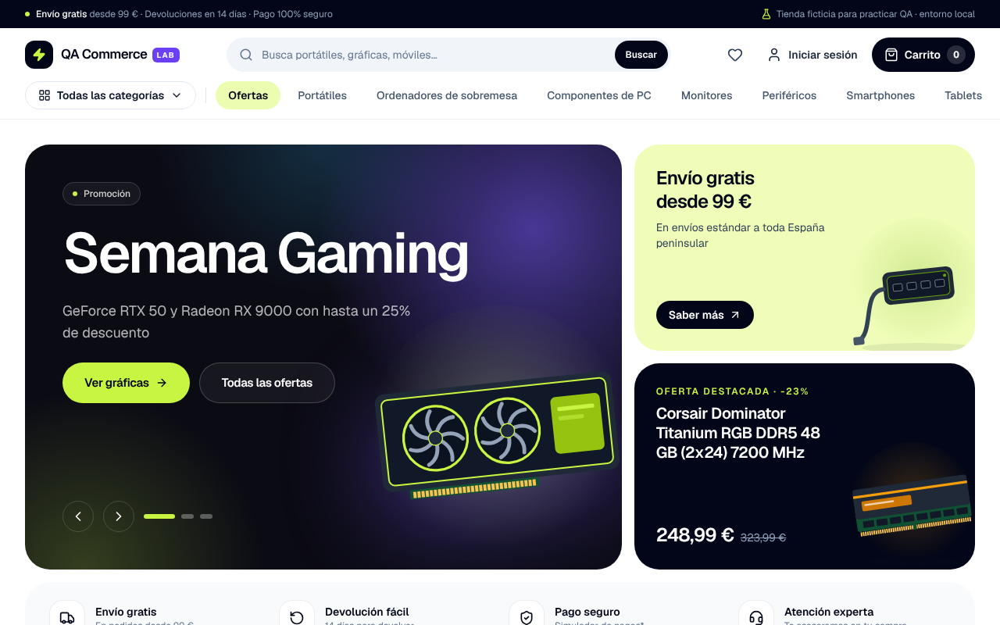
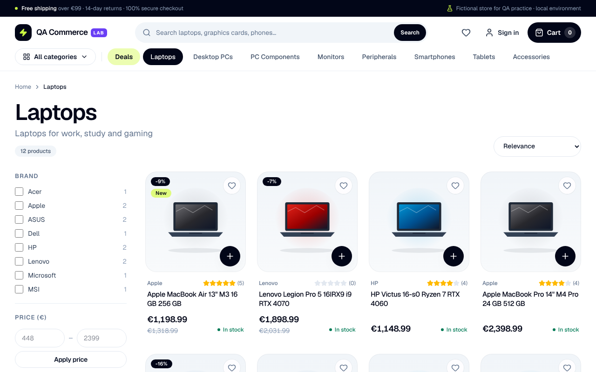

# QA Commerce Lab

**A complete, realistic electronics store built as a *System Under Test* to practise web and API test automation** (Playwright, Cypress, Selenium, WebdriverIO, Postman, REST Assured…).

It is not a shallow demo: frontend, backend, database, REST API documented with OpenAPI, authentication with revocable sessions, roles, a 168-product catalog, cart, coupons, transactional checkout, simulated payments, orders with a state machine, customer area, admin panel and **dedicated testing infrastructure** (deterministic data, scenarios, per-run isolation, fault simulation and cleanup).

> The catalog uses **real** brand and model names as a reference, but prices, stock, reviews, users, orders and payments are **fictional**. Brands belong to their respective owners; this project has no relationship with them and no commercial activity. Never enter real data (cards, addresses, passwords).



| Catalog | Product page | Admin panel |
|---|---|---|
|  |  |  |

## Contents

- [Quick start](#quick-start)
- [URLs and credentials](#urls-and-credentials)
- [Architecture](#architecture)
- [Features](#features)
- [QA infrastructure](#qa-infrastructure)
- [Local development without Docker](#local-development-without-docker)
- [Useful commands](#useful-commands)
- [Deployment](#deployment)
- [Troubleshooting](#troubleshooting)
- [Documentation](#documentation)

## Quick start

Requirements: **Docker** with Docker Compose v2.

```bash
git clone https://github.com/yagoaresarmesto/qa-commerce-lab.git
cd qa-commerce-lab
docker compose up --build
```

The first start applies the migrations and loads the reference dataset automatically.

## URLs and credentials

| Resource | URL |
|---|---|
| Store | http://localhost:3000 |
| API | http://localhost:3001/api (also via http://localhost:3000/api) |
| Swagger UI | http://localhost:3001/api/docs |
| OpenAPI JSON / YAML | http://localhost:3001/api/docs-json · `/api/docs-yaml` |
| Health / info | http://localhost:3001/api/health/ready · http://localhost:3001/api/info |
| Mailpit (optional) | http://localhost:8025 (`SMTP_HOST=mailpit docker compose --profile mail up`) |

Sample local credentials (lab only):

| User | Password | Profile |
|---|---|---|
| `admin@qacommerce.test` | `Admin123!` | Administrator |
| `customer@qacommerce.test` | `Customer123!` | Standard customer |
| `orders@qacommerce.test` | `Customer123!` | Orders in every status |
| `favorites@qacommerce.test` · `addresses@qacommerce.test` · `noorders@qacommerce.test` | `Customer123!` | Favorites · several addresses · no orders |
| `disabled@qacommerce.test` | `Customer123!` | Disabled account |
| `cart@` · `coupon@` · `cartissues@` · `returnable@` · `cancellable@` · `fulladdresses@` · `edge.case+qa@` (all `@qacommerce.test`) | `Customer123!` | Ready-made cases: cart to check out, coupon applied, cart with issues, returnable order, cancellable order, address limit, edge-case data |
| `support@qacommerce.test` | `Admin123!` | Second administrator |

Approved test card: `4242 4242 4242 4242`, any future date and CVC. Local testing API: header `X-Test-Api-Key: local-test-api-key`. More data in [docs/TESTING.md](docs/TESTING.md).

## Architecture

```
Browser / test tools
        │  (same origin)
        ▼
 React storefront (Vite) ──/api──▶ NestJS REST API ──▶ PostgreSQL 16 (Prisma)
                                     ├─ Swagger / OpenAPI
                                     ├─ Payment simulator and jobs
                                     ├─ Simulated mailbox
                                     └─ Testing API (local/testing only)
```

| Layer | Technology |
|---|---|
| Frontend | React 19, TypeScript, Vite 7, React Router 7, TanStack Query, React Hook Form + Zod, Tailwind CSS 4, Radix UI |
| Backend | Node.js 22, NestJS 11, strict TypeScript, class-validator, Pino, JWT + database sessions |
| Data | PostgreSQL 16, Prisma 6 (versioned migrations, deterministic seed) |
| Infra | Docker, Docker Compose, Caddy (HTTPS), GitHub Actions, GHCR |

Details: [docs/ARCHITECTURE.md](docs/ARCHITECTURE.md).

```
apps/api      NestJS API (+ prisma/, test/)
apps/web      Storefront and admin panel (React)
deploy/vps    VPS deployment: Caddy + demo + testing + PostgreSQL
docs/         Functional, technical, API, QA and deployment documentation
Dockerfile    All-in-one image for remote environments
```

## Features

- **Catalog**: home page with banners and dynamic sections, 16 categories (2 levels), accent-insensitive search with suggestions, combinable filters with facets, 8 sort orders, pagination, product pages with gallery, specifications and reviews.
- **Users**: sign-up, sign-in, sign-out, token refresh, revocable sessions, profile, password change and recovery (simulated e-mail), addresses with Spanish validation.
- **Shopping**: persistent cart (user or guest, merged on sign-in), coupons with 9 rules, standard/express/pickup-point shipping, 4-step checkout, payments with test cards or bank transfer, idempotency and concurrent stock control.
- **Orders**: 8 statuses with validated transitions, history, cancellations with refund and restock, returns within a deadline, payment retry, automatic cancellation of expired reservations.
- **Customer area**: overview, orders, personal details, addresses, password and sessions, favorites and reviews.
- **Administration**: dashboard with metrics, products (CRUD, atomic stock, enable/disable), orders (status workflow, confirm bank transfers), users (status and role) and coupons.

Full business rules: [docs/FUNCTIONAL.md](docs/FUNCTIONAL.md).

## QA infrastructure

- **Deterministic dataset**: 168 products with documented special inventory (out of stock, last unit, discontinued), 9 coupons covering every error case, users in specific states, 9 reference orders (one per status), ~500 reviews.
- **Testing API** (`/api/test/*`, protected with `X-Test-Api-Key`, absent from the demo): global reset, reference restore, creation of users/products/coupons/carts/orders in any status, tokens with configurable TTL, session expiry, e-mails, jobs.
- **27 ready-made scenarios** (`checkout-ready`, `cart-with-issues`, `concurrent-last-unit`, `shipped-order`, `expired-coupon`, `expired-session`…).
- **Per-run isolation** (`runId` / `X-Test-Run-Id`) and a parallel-safe cleanup `DELETE /api/test/runs/{runId}`.
- **Controlled fault simulation**: 500/503/… errors, latency and timeouts scoped by run or user, with a number of uses and an expiry.
- **Deterministic payments**: approved, declined, insufficient funds, pending→approved/declined, gateway error (502) and timeout (504).
- **No artificial blockers**: no CAPTCHA, no lockout after failed attempts, no e-mail verification, no rate limiting in testing.
- **Selectors**: semantic HTML, exact labels, ARIA roles and stable `data-testid` attributes.

Complete automation guide: [docs/TESTING.md](docs/TESTING.md).

## Local development without Docker

Requirements: Node.js 22 and PostgreSQL 16.

```bash
npm install
cp apps/api/.env.example apps/api/.env   # adjust DATABASE_URL if needed
npm run db:deploy                         # apply migrations
npm run db:reset                          # load the reference dataset
npm run dev                               # API :3001 + storefront :3000 (proxy /api)
```

## Useful commands

| Command | Description |
|---|---|
| `npm run dev` | API and storefront in development mode |
| `npm run build` | Build the API and the storefront |
| `npm run lint` · `npm run typecheck` | Code quality |
| `npm test` | Unit tests (pricing engine, statuses, payments) |
| `npm run test:e2e` | Integration tests against PostgreSQL (`DATABASE_URL`) |
| `npm run db:migrate` | Create a new migration (development) |
| `npm run db:deploy` | Apply pending migrations |
| `npm run db:seed` | Restore the reference data without deleting run data |
| `npm run db:reset` | Wipe everything and seed from scratch (deterministic IDs) |
| `docker compose up --build` | Full local environment |
| `docker compose exec api node dist/prisma/seed.js --reset` | Full reset inside Docker |
| `docker compose down -v` | Stop the environment and delete the database |

## Deployment

The repository is ready to be deployed to the Internet as **two separate environments built from the same code**: a *public demo* (no testing API, rate limiting and a nightly reset) and *remote testing* (with the protected testing API). Recommendation: a ~€6-8/month VPS with Docker Compose and automatic HTTPS (Caddy); PaaS alternative with `render.yaml`.

Feasibility study, costs, provider comparison and step-by-step guide: [docs/DEPLOYMENT.md](docs/DEPLOYMENT.md).

CI/CD (`.github/workflows`): **CI** (lint, types, unit tests, integration tests with PostgreSQL, migration check, build and image build) and **Release** (publishes the image to GHCR and, if you configure it, deploys to the VPS over SSH with a health check).

## Troubleshooting

| Problem | Solution |
|---|---|
| Port 3000/3001/5433 is already in use | Change `WEB_PORT`, `API_PORT` or `DB_PORT` in a `.env` file at the repository root (see `.env.example`) |
| `api` does not start: `Invalid environment configuration` | Check the variables; outside `local`, `JWT_SECRET` must be ≥ 32 characters and `TEST_API_KEY` ≥ 24 |
| The store loads but shows no products | `docker compose logs api` (migrations/seed) and `docker compose exec api node dist/prisma/seed.js --reset` |
| `401 TEST_API_KEY_INVALID` | Send `X-Test-Api-Key` (locally: `local-test-api-key`) |
| `404` on `/api/test/*` | You are on `APP_ENV=demo/production`: the testing API does not exist there |
| `403 GLOBAL_RESET_DISABLED` | Global reset is disabled in that environment: use `DELETE /api/test/runs/{runId}` or `POST /api/test/seed` |
| Reference data changed after running tests | `POST /api/test/seed` (or `npm run db:seed`) |
| `429 RATE_LIMITED` | Only happens with `RATE_LIMIT_ENABLED=true` (demo) |
| Prisma: `Can't reach database server` | Check `DATABASE_URL` and that PostgreSQL is up (`docker compose ps`) |
| Changes to `schema.prisma` | `npm run db:migrate -- --name <change>` and commit the migration (CI checks they match) |

## Documentation

| Document | Contents |
|---|---|
| [docs/TESTING.md](docs/TESTING.md) | QA automation guide: data, testing API, scenarios, isolation, faults, selectors |
| [docs/FUNCTIONAL.md](docs/FUNCTIONAL.md) | Features, roles, permissions, business rules, order statuses |
| [docs/API.md](docs/API.md) | Conventions, authentication, errors, endpoints and examples |
| [docs/ARCHITECTURE.md](docs/ARCHITECTURE.md) | Stack, modules, data model, concurrency, security |
| [docs/DEPLOYMENT.md](docs/DEPLOYMENT.md) | Feasibility, costs, demo/testing separation, deployment guide |
| [docs/PLAN.md](docs/PLAN.md) | Analysis, risks and phase status |

## License

No license has been chosen yet: pick one (for example MIT) before publishing it as open source. Educational project with no commercial activity.
