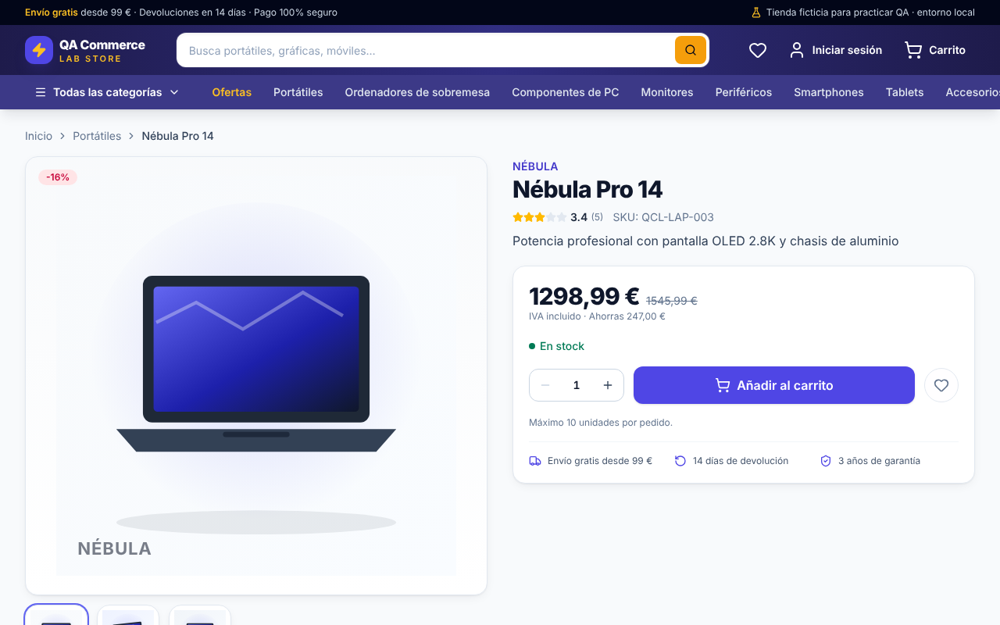
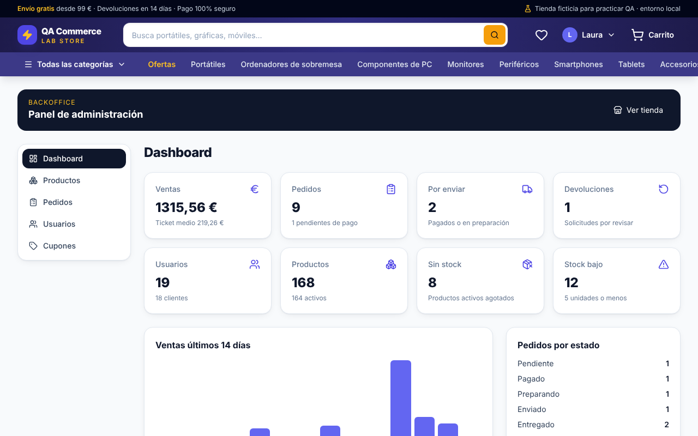

# QA Commerce Lab

**Tienda de electrónica completa y realista diseñada como *System Under Test* para practicar automatización de pruebas web y API** (Playwright, Cypress, Selenium, WebdriverIO, Postman, REST Assured…).

No es una demo superficial: frontend, backend, base de datos, API REST documentada con OpenAPI, autenticación con sesiones revocables, roles, catálogo de 168 productos, carrito, cupones, checkout transaccional, pagos simulados, pedidos con máquina de estados, área privada, panel de administración e **infraestructura específica para testing** (datos deterministas, escenarios, aislamiento por ejecución, simulación de fallos y limpieza).

> Todos los productos, marcas, precios, usuarios y pagos son **ficticios**. Nunca introduzcas datos reales.


| Catálogo | Ficha de producto | Panel de administración |
|---|---|---|
|  |  |  |

## Contenido

- [Arranque rápido](#arranque-rápido)
- [URLs y credenciales](#urls-y-credenciales)
- [Arquitectura](#arquitectura)
- [Funcionalidades](#funcionalidades)
- [Infraestructura para QA](#infraestructura-para-qa)
- [Desarrollo local sin Docker](#desarrollo-local-sin-docker)
- [Comandos útiles](#comandos-útiles)
- [Despliegue](#despliegue)
- [Solución de problemas](#solución-de-problemas)
- [Documentación](#documentación)

## Arranque rápido

Requisitos: **Docker** con Docker Compose v2.

```bash
git clone https://github.com/yagoaresarmesto/qa-commerce-lab.git
cd qa-commerce-lab
docker compose up --build
```

El primer arranque aplica las migraciones y carga el dataset de referencia automáticamente.

## URLs y credenciales

| Recurso | URL |
|---|---|
| Tienda | http://localhost:3000 |
| API | http://localhost:3001/api (también vía http://localhost:3000/api) |
| Swagger UI | http://localhost:3001/api/docs |
| OpenAPI JSON / YAML | http://localhost:3001/api/docs-json · `/api/docs-yaml` |
| Health / info | http://localhost:3001/api/health/ready · http://localhost:3001/api/info |
| Mailpit (opcional) | http://localhost:8025 (`SMTP_HOST=mailpit docker compose --profile mail up`) |

Credenciales locales de ejemplo (solo laboratorio):

| Usuario | Contraseña | Perfil |
|---|---|---|
| `admin@qacommerce.test` | `Admin123!` | Administrador |
| `customer@qacommerce.test` | `Customer123!` | Cliente estándar |
| `orders@qacommerce.test` | `Customer123!` | Pedidos en todos los estados |
| `favorites@qacommerce.test` · `addresses@qacommerce.test` · `noorders@qacommerce.test` | `Customer123!` | Favoritos · varias direcciones · sin pedidos |
| `disabled@qacommerce.test` | `Customer123!` | Cuenta desactivada |

Tarjeta de prueba aprobada: `4242 4242 4242 4242`, cualquier fecha futura y CVC. API de testing local: cabecera `X-Test-Api-Key: local-test-api-key`. Más datos en [docs/TESTING.md](docs/TESTING.md).

## Arquitectura

```
Navegador / herramientas de test
        │  (mismo origen)
        ▼
 Storefront React (Vite) ──/api──▶ API REST NestJS ──▶ PostgreSQL 16 (Prisma)
                                     ├─ Swagger / OpenAPI
                                     ├─ Simulador de pagos y jobs
                                     ├─ Buzón de email simulado
                                     └─ API de testing (solo local/testing)
```

| Capa | Tecnología |
|---|---|
| Frontend | React 19, TypeScript, Vite 7, React Router 7, TanStack Query, React Hook Form + Zod, Tailwind CSS 4, Radix UI |
| Backend | Node.js 22, NestJS 11, TypeScript estricto, class-validator, Pino, JWT + sesiones en BD |
| Datos | PostgreSQL 16, Prisma 6 (migraciones versionadas, seed determinista) |
| Infra | Docker, Docker Compose, Caddy (HTTPS), GitHub Actions, GHCR |

Detalles: [docs/ARCHITECTURE.md](docs/ARCHITECTURE.md).

```
apps/api      API NestJS (+ prisma/, test/)
apps/web      Storefront y panel admin (React)
deploy/vps    Despliegue en VPS: Caddy + demo + testing + PostgreSQL
docs/         Documentación funcional, técnica, API, QA y despliegue
Dockerfile    Imagen all-in-one para entornos remotos
```

## Funcionalidades

- **Catálogo**: home con banners y secciones dinámicas, 16 categorías (2 niveles), búsqueda sin tildes con sugerencias, filtros combinables con facetas, 8 ordenaciones, paginación, fichas con galería, especificaciones y reseñas.
- **Usuarios**: registro, login, logout, renovación de tokens, sesiones revocables, perfil, cambio y recuperación de contraseña (email simulado), direcciones con validación española.
- **Compra**: carrito persistente (usuario o invitado, con fusión al iniciar sesión), cupones con 9 reglas, envío estándar/exprés/punto de recogida, checkout en 4 pasos, pagos con tarjetas de prueba o transferencia, idempotencia y control de stock concurrente.
- **Pedidos**: 8 estados con transiciones validadas, historial, cancelaciones con reembolso y reposición, devoluciones con plazo, reintento de pago, cancelación automática de reservas caducadas.
- **Área privada**: resumen, pedidos, datos personales, direcciones, contraseña y sesiones, favoritos y reseñas.
- **Administración**: dashboard con métricas, productos (CRUD, stock atómico, activar/desactivar), pedidos (flujo de estados, confirmar transferencias), usuarios (estado y rol) y cupones.

Reglas de negocio completas: [docs/FUNCTIONAL.md](docs/FUNCTIONAL.md).

## Infraestructura para QA

- **Dataset determinista**: 168 productos con inventario especial documentado (agotados, última unidad, descatalogados), 9 cupones con cada caso de error, usuarios en estados concretos, 9 pedidos de referencia (uno por estado), ~500 reseñas.
- **API de testing** (`/api/test/*`, protegida con `X-Test-Api-Key`, inexistente en la demo): reset global, restauración de referencia, creación de usuarios/productos/cupones/carritos/pedidos en cualquier estado, tokens con TTL configurable, caducidad de sesiones, emails, jobs.
- **27 escenarios** listos (`checkout-ready`, `cart-with-issues`, `concurrent-last-unit`, `shipped-order`, `expired-coupon`, `expired-session`…).
- **Aislamiento por ejecución** (`runId` / `X-Test-Run-Id`) y limpieza `DELETE /api/test/runs/{runId}` segura en paralelo.
- **Simulación controlada de fallos**: errores 500/503/…, latencia y timeouts acotados por ejecución o usuario, con número de usos y caducidad.
- **Pagos deterministas**: aprobado, rechazado, fondos insuficientes, pendiente→aprobado/rechazado, error de pasarela (502) y timeout (504).
- **Sin bloqueos artificiales**: ni CAPTCHA, ni bloqueo por intentos, ni verificación de email, ni rate limiting en testing.
- **Selectores**: HTML semántico, labels exactos, roles ARIA y `data-testid` estables.

Guía completa para automatizar: [docs/TESTING.md](docs/TESTING.md).

## Desarrollo local sin Docker

Requisitos: Node.js 22 y PostgreSQL 16.

```bash
npm install
cp apps/api/.env.example apps/api/.env   # ajusta DATABASE_URL si es necesario
npm run db:deploy                         # aplica migraciones
npm run db:reset                          # carga el dataset de referencia
npm run dev                               # API :3001 + storefront :3000 (proxy /api)
```

## Comandos útiles

| Comando | Descripción |
|---|---|
| `npm run dev` | API y storefront en modo desarrollo |
| `npm run build` | Compila API y storefront |
| `npm run lint` · `npm run typecheck` | Calidad de código |
| `npm test` | Tests unitarios (motor de precios, estados, pagos) |
| `npm run test:e2e` | Tests de integración contra PostgreSQL (`DATABASE_URL`) |
| `npm run db:migrate` | Crea una migración nueva (desarrollo) |
| `npm run db:deploy` | Aplica migraciones pendientes |
| `npm run db:seed` | Restaura los datos de referencia sin borrar los de ejecuciones |
| `npm run db:reset` | Borra todo y siembra desde cero (IDs deterministas) |
| `docker compose up --build` | Entorno local completo |
| `docker compose exec api node dist/prisma/seed.js --reset` | Reset completo dentro de Docker |
| `docker compose down -v` | Para el entorno y elimina la base de datos |

## Despliegue

El repositorio está preparado para desplegarse en Internet con **dos entornos separados del mismo código**: *demo pública* (sin API de testing, con rate limiting y reset nocturno) y *testing remoto* (con API de testing protegida). Recomendación: un VPS de ~6-8 €/mes con Docker Compose y HTTPS automático (Caddy); alternativa PaaS con `render.yaml`.

Estudio de viabilidad, costes, comparativa de proveedores y guía paso a paso: [docs/DEPLOYMENT.md](docs/DEPLOYMENT.md).

CI/CD (`.github/workflows`): **CI** (lint, tipos, unitarios, integración con PostgreSQL, comprobación de migraciones, build y build de la imagen) y **Release** (publica la imagen en GHCR y, si lo configuras, despliega por SSH en el VPS con comprobación de salud).

## Solución de problemas

| Problema | Solución |
|---|---|
| El puerto 3000/3001/5433 está ocupado | Cambia `WEB_PORT`, `API_PORT` o `DB_PORT` en un fichero `.env` en la raíz (ver `.env.example`) |
| `api` no arranca: `Invalid environment configuration` | Revisa las variables; fuera de `local` `JWT_SECRET` debe tener ≥ 32 caracteres y `TEST_API_KEY` ≥ 24 |
| La tienda carga pero sin productos | `docker compose logs api` (migraciones/seed) y `docker compose exec api node dist/prisma/seed.js --reset` |
| `401 TEST_API_KEY_INVALID` | Envía `X-Test-Api-Key` (en local: `local-test-api-key`) |
| `404` en `/api/test/*` | Estás en `APP_ENV=demo/production`: la API de testing no existe allí |
| `403 GLOBAL_RESET_DISABLED` | El reset global está deshabilitado en el entorno: usa `DELETE /api/test/runs/{runId}` o `POST /api/test/seed` |
| Los datos de referencia han cambiado tras ejecutar pruebas | `POST /api/test/seed` (o `npm run db:seed`) |
| `429 RATE_LIMITED` | Solo ocurre con `RATE_LIMIT_ENABLED=true` (demo) |
| Prisma: `Can't reach database server` | Comprueba `DATABASE_URL` y que PostgreSQL esté arriba (`docker compose ps`) |
| Cambios en `schema.prisma` | `npm run db:migrate -- --name <cambio>` y commitea la migración (CI comprueba que coinciden) |

## Documentación

| Documento | Contenido |
|---|---|
| [docs/TESTING.md](docs/TESTING.md) | Guía para QA Automation: datos, API de testing, escenarios, aislamiento, fallos, selectores |
| [docs/FUNCTIONAL.md](docs/FUNCTIONAL.md) | Funcionalidades, roles, permisos, reglas de negocio, estados de pedido |
| [docs/API.md](docs/API.md) | Convenciones, autenticación, errores, endpoints y ejemplos |
| [docs/ARCHITECTURE.md](docs/ARCHITECTURE.md) | Stack, módulos, modelo de datos, concurrencia, seguridad |
| [docs/DEPLOYMENT.md](docs/DEPLOYMENT.md) | Viabilidad, costes, separación demo/testing, guía de despliegue |
| [docs/PLAN.md](docs/PLAN.md) | Análisis, riesgos y estado de las fases |

## Licencia

Todavía no se ha definido una licencia: elige una (por ejemplo MIT) antes de publicarlo como código abierto. Proyecto educativo sin actividad comercial.
