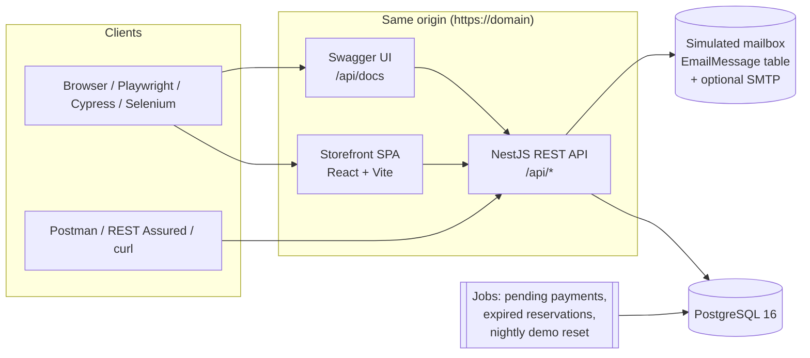
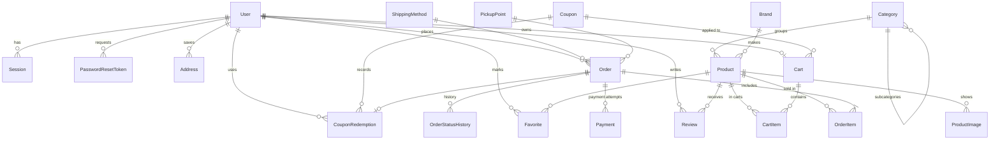

# Technical architecture

## 1. Overview



- **Monorepo** with npm workspaces: `apps/api` (NestJS) and `apps/web` (React).
- **Same origin** in every environment: Vite proxies `/api` in development, nginx in local Docker and the API itself serves the SPA build in the *all-in-one* deployment image. Benefits: no CORS issues, first-party cookies for the refresh token and simple URLs for automation.

## 2. Stack decisions

| Layer | Choice | Reason |
|---|---|---|
| Frontend | **React 19 + Vite 7 + TypeScript** | Static SPA that is easy to deploy and to serve from the API; Next.js adds no value (no real SEO or SSR needs) and would complicate deployment |
| Routing | React Router 7 (library mode, `createBrowserRouter`) | Standard, shareable English URLs (`/product/{slug}`, `/category/{slug}`, `/account/orders`...) |
| Data | TanStack Query 5 | Caching, controlled retries, *polling* (pending payments), loading/error states |
| Forms | React Hook Form + Zod | Declarative client validation; the backend remains the source of truth |
| Styles | Tailwind CSS 4 | Custom design system with tokens (`brand`, `accent`) and the Geist font |
| Accessibility | Radix UI (Dialog, DropdownMenu) + semantic HTML | Correct focus, keyboard and ARIA handling in modals and menus |
| Backend | **NestJS 11 + strict TypeScript** | Modular architecture, DI, DTO validation and OpenAPI generated from the code |
| ORM | **Prisma 6** + PostgreSQL 16 | Versioned migrations, end-to-end typing, interactive transactions |
| Auth | JWT HS256 (access) + database session (opaque refresh) | Instantly revocable tokens, ideal for testing expiry/revocation |
| Passwords | Node `scrypt` (N=2^15) | No native dependencies, OWASP-recommended parameters |
| Logs | Pino (`nestjs-pino`), structured JSON | `requestId`, `testRunId`, sensitive headers redacted |
| Infra | Docker, Docker Compose, Caddy (automatic HTTPS) | Reproducible locally and on a cheap VPS |

Versions are pinned to the stable major lines (Nest 11, Prisma 6, TS 5.9, Vite 7) rather than the freshly released ones, to favour stability.

## 3. Repository layout

```
qa-commerce-lab/
├── apps/
│   ├── api/                      # NestJS
│   │   ├── prisma/               # schema.prisma, migrations, seed CLI
│   │   ├── src/
│   │   │   ├── common/           # errors, global filter, guards, decorators, validation, request context
│   │   │   ├── config/           # typed configuration validated per environment (zod)
│   │   │   ├── modules/
│   │   │   │   ├── auth/         # registration, login, refresh, logout, recovery
│   │   │   │   ├── users/        # profile, password, sessions, addresses
│   │   │   │   ├── catalog/      # products, categories, brands, home
│   │   │   │   ├── media/        # own SVG product illustrations
│   │   │   │   ├── cart/         # cart, coupons, shipping, (pure) pricing engine
│   │   │   │   ├── orders/       # checkout, payments (simulator), state machine, lifecycle
│   │   │   │   ├── engagement/   # favorites and reviews
│   │   │   │   ├── admin/        # administration panel
│   │   │   │   ├── jobs/         # periodic jobs and scheduled reset
│   │   │   │   ├── mail/         # simulated mailbox (+ optional SMTP)
│   │   │   │   ├── health/       # health checks and environment info
│   │   │   │   └── testing/      # testing API, scenarios, cleanup, faults (local/testing only)
│   │   │   └── seed/             # deterministic reference dataset
│   │   └── test/                 # technical integration tests (supertest + PostgreSQL)
│   └── web/                      # React + Vite
│       └── src/
│           ├── auth/             # session provider and route guards
│           ├── components/       # ui/ (design system), layout/, product/, checkout/
│           ├── lib/              # HTTP client, API types, queries, formatting
│           └── pages/            # store, account (account/), administration (admin/)
├── deploy/vps/                   # production docker-compose, Caddy, deployment and backup scripts
├── docs/                         # documentation
├── Dockerfile                    # all-in-one image (API + SPA) for deployments
├── docker-compose.yml            # full local environment
└── render.yaml                   # PaaS alternative (Render Blueprint)
```

## 4. Backend

### Modules and layers

Every domain module has a **controller** (HTTP, Swagger, input validation), a **service** (business rules, transactions) and **DTOs** (input/output contracts). Pure, critical logic is isolated and covered by unit tests:

- `cart/pricing.ts`: pricing engine (subtotal, discounts, free shipping, VAT).
- `orders/order-state-machine.ts`: allowed transitions per actor.
- `orders/payment-simulator.ts`: test cards, Luhn and scenarios.

### Requests

1. `pino-http` assigns `X-Request-Id`; `RequestContextMiddleware` creates a context (`AsyncLocalStorage`) with the `requestId` and, in local/testing, the `X-Test-Run-Id`.
2. Global guards: `ConfigurableThrottlerGuard` (only if `RATE_LIMIT_ENABLED`) and `AuthGuard` (protected by default; `@Public`, `@OptionalAuth`, `@Roles`). The guard validates the JWT **and** the database session (immediate revocation).
3. `FaultInjectionInterceptor` applies fault rules (inactive outside testing).
4. Global `ValidationPipe` (whitelist, `forbidNonWhitelisted`, transformation, one error per field).
5. `AllExceptionsFilter` normalises **any** error (business, Nest, Prisma or body-parser) into the documented format.

### Consistency and concurrency

| Risk | Mechanism |
|---|---|
| Selling more than the stock | `UPDATE ... SET stock = stock - n WHERE stock >= n` inside the order transaction |
| Double click / several tabs | `SELECT ... FOR UPDATE` on the user cart + `Idempotency-Key` with a unique index `(userId, idempotencyKey)` |
| Replay after a timeout | Idempotency with a body hash (`IDEMPOTENCY_KEY_REUSED` if it changes) |
| Two simultaneous payments | Conditional transition of `paymentStatus` to `PROCESSING` (only one succeeds) |
| Concurrent status changes | Optimistic locking `UPDATE ... WHERE status = <previous>` |
| Global coupon limit | Conditional increment `timesUsed < usageLimit` |
| Concurrent resets | Serialised queue in `SeedService` |
| Prices tampered with on the client | Totals always recomputed on the server + `expectedTotalCents` |

### Data model



Auxiliary tables: `EmailMessage` (mailbox), `Banner` (home), `TestAuditLog` (testing API audit).

Conventions:

- Amounts in **cents** (`Int`), prices including VAT.
- `OrderItem` and `Order.shippingAddress` are **snapshots**: history does not change when products or addresses change (`OrderItem.productId` becomes `NULL` if the product is deleted).
- Referential integrity with explicit `onDelete` (Cascade for dependent data, Restrict for the catalog, SetNull for history).
- `isReference` marks seed data; `testRunId` tags what automation creates. `Product.searchText` (normalised, accent-free text) and `discountPercent` are derived fields maintained by the application to search and sort in the database.
- `Order.stockReserved` tells whether the order holds inventory (prevents double restocking).

## 5. Frontend

- `lib/api.ts`: `fetch` client with the access token **in memory**, silent refresh on `TOKEN_EXPIRED` (a single shared refresh request), session-expired event, guest cart (`X-Cart-Token`) and optional `X-Test-Run-Id` header.
- `auth/AuthProvider.tsx`: restores the session on load (httpOnly cookie), merges the guest cart after login and clears the cache on sign-out.
- Server state with TanStack Query; UI state in the URL (filters, sort, page) so it is shareable and automatable.
- Custom design system in `components/ui` (Button, Input/Select/Textarea/Checkbox with associated label and error, Modal/ConfirmDialog, Badge, Alert, Skeleton, EmptyState, ErrorState, Pagination, Price, Rating, QuantityStepper, Breadcrumbs).
- Accessibility: *skip link*, focus management on navigation, ARIA roles (search combobox, rating radiogroup, gallery tabs), `aria-live` on results and quantities, `prefers-reduced-motion`, carousel without auto-rotation (WCAG 2.2.2).
- Formatting: English UI, euros formatted with `en-IE` (`€1,198.99`) and dates with `en-GB` (`14 Nov 2026`).

## 6. Per-environment configuration

`APP_ENV` ∈ `local | testing | demo | production` sets the defaults; configuration is validated at start-up (the app refuses to start with an insecure configuration):

| Setting | local | testing | demo / production |
|---|---|---|---|
| Testing API | ✅ (default key) | ✅ (key ≥ 24 characters required) | ❌ **always** (the module is not registered) |
| Global reset | ✅ | ❌ by default | ❌ |
| Global faults | ✅ | ❌ by default | ❌ |
| Rate limiting | ❌ | ❌ | ✅ |
| `JWT_SECRET` | default | ≥ 32 characters required | ≥ 32 characters required |
| `Secure` cookie | ❌ | ✅ | ✅ |
| Logs | human-readable | JSON | JSON |

Full list of variables in [`apps/api/.env.example`](../apps/api/.env.example) and [`deploy/vps/*.env.example`](../deploy/vps).

## 7. Security

- Passwords hashed with scrypt and compared in constant time; login takes a similar time whether or not the user exists.
- Password reset tokens and refresh tokens stored as a **hash** (SHA-256); reset tokens are single-use.
- Security headers with Helmet (strict CSP when serving the SPA), `x-powered-by` disabled, CORS restricted to configured origins.
- Logs with `authorization`, `cookie` and `x-test-api-key` redacted. Full card numbers are never stored.
- Testing API: module not registered in demo/production, technical key compared in constant time, limited scope (runId/user), audit in `TestAuditLog`.
- Each remote environment database has **its own role** (the demo cannot access the testing database).

## 8. Bundled technical tests

These tests verify the SUT itself (they are not the lab's automation framework):

- `npm test`: unit tests for the pricing engine, state machine and payment simulator.
- `npm run test:e2e`: integration with a real PostgreSQL (health, deterministic catalog, filters, error format, testing API protection, full purchase with idempotency and stock, last-unit concurrency, per-run cleanup).
- CI: lint, types, unit tests, integration tests, check that the schema matches the migrations, build and Docker image build.
