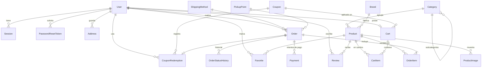

# Arquitectura técnica

## 1. Visión general


- **Monorepo** con npm workspaces: `apps/api` (NestJS) y `apps/web` (React).
- **Mismo origen** en todos los entornos: Vite proxifica `/api` en desarrollo, nginx en Docker local y la propia API sirve el build de la SPA en la imagen *all-in-one* de despliegue. Ventajas: sin problemas de CORS, cookies first-party para el refresh token y URLs simples para la automatización.

## 2. Decisiones de stack

| Capa | Elección | Motivo |
|---|---|---|
| Frontend | **React 19 + Vite 7 + TypeScript** | SPA estática fácil de desplegar y servir desde la API; Next.js no aporta valor (no hay SEO real ni SSR necesario) y complicaría el despliegue |
| Routing | React Router 7 (modo librería, `createBrowserRouter`) | Estándar, URLs en castellano compartibles |
| Datos | TanStack Query 5 | Caché, reintentos controlados, *polling* (pagos pendientes), estados de carga/error |
| Formularios | React Hook Form + Zod | Validación de cliente declarativa; el backend sigue siendo la fuente de verdad |
| Estilos | Tailwind CSS 4 | Sistema de diseño propio con tokens (`brand`, `accent`) |
| Accesibilidad | Radix UI (Dialog, DropdownMenu) + HTML semántico | Foco, teclado y ARIA correctos en modales y menús |
| Backend | **NestJS 11 + TypeScript estricto** | Arquitectura modular, DI, validación con DTOs y OpenAPI generada desde el código |
| ORM | **Prisma 6** + PostgreSQL 16 | Migraciones versionadas, tipado extremo a extremo, transacciones interactivas |
| Auth | JWT HS256 (access) + sesión en BD (refresh opaco) | Tokens revocables al instante, ideal para probar caducidad/revocación |
| Contraseñas | `scrypt` de Node (N=2^15) | Sin dependencias nativas, parámetros recomendados por OWASP |
| Logs | Pino (`nestjs-pino`), JSON estructurado | `requestId`, `testRunId`, cabeceras sensibles redactadas |
| Infra | Docker, Docker Compose, Caddy (HTTPS automático) | Reproducible en local y en un VPS barato |

Versiones fijadas en las ramas mayores estables (Nest 11, Prisma 6, TS 5.9, Vite 7) en lugar de las recién publicadas, para priorizar estabilidad.

## 3. Estructura del repositorio

```
qa-commerce-lab/
├── apps/
│   ├── api/                      # NestJS
│   │   ├── prisma/               # schema.prisma, migraciones, seed CLI
│   │   ├── src/
│   │   │   ├── common/           # errores, filtro global, guards, decoradores, validación, contexto de petición
│   │   │   ├── config/           # configuración tipada y validada por entorno (zod)
│   │   │   ├── modules/
│   │   │   │   ├── auth/         # registro, login, refresh, logout, recuperación
│   │   │   │   ├── users/        # perfil, contraseña, sesiones, direcciones
│   │   │   │   ├── catalog/      # productos, categorías, marcas, home
│   │   │   │   ├── media/        # ilustraciones SVG propias de producto
│   │   │   │   ├── cart/         # carrito, cupones, envíos, motor de precios (puro)
│   │   │   │   ├── orders/       # checkout, pagos (simulador), máquina de estados, ciclo de vida
│   │   │   │   ├── engagement/   # favoritos y reseñas
│   │   │   │   ├── admin/        # panel de administración
│   │   │   │   ├── jobs/         # jobs periódicos y reset programado
│   │   │   │   ├── mail/         # buzón simulado (+ SMTP opcional)
│   │   │   │   ├── health/       # health checks e info del entorno
│   │   │   │   └── testing/      # API de testing, escenarios, limpieza, faults (solo local/testing)
│   │   │   └── seed/             # dataset de referencia determinista
│   │   └── test/                 # pruebas de integración técnicas (supertest + PostgreSQL)
│   └── web/                      # React + Vite
│       └── src/
│           ├── auth/             # proveedor de sesión y guards de rutas
│           ├── components/       # ui/ (design system), layout/, product/, checkout/
│           ├── lib/              # cliente HTTP, tipos de la API, queries, formato
│           └── pages/            # tienda, cuenta (account/), administración (admin/)
├── deploy/vps/                   # docker-compose de producción, Caddy, scripts de despliegue y backup
├── docs/                         # documentación
├── Dockerfile                    # imagen all-in-one (API + SPA) para despliegues
├── docker-compose.yml            # entorno local completo
└── render.yaml                   # alternativa PaaS (Render Blueprint)
```

## 4. Backend

### Módulos y capas

Cada módulo de dominio tiene **controller** (HTTP, Swagger, validación de entrada), **service** (reglas de negocio, transacciones) y **DTOs** (contratos de entrada/salida). La lógica pura y crítica está aislada y cubierta por tests unitarios:

- `cart/pricing.ts`: motor de precios (subtotal, descuentos, envío gratis, IVA).
- `orders/order-state-machine.ts`: transiciones permitidas por actor.
- `orders/payment-simulator.ts`: tarjetas de prueba, Luhn y escenarios.

### Peticiones

1. `pino-http` asigna `X-Request-Id`; `RequestContextMiddleware` crea un contexto (`AsyncLocalStorage`) con el `requestId` y, en local/testing, el `X-Test-Run-Id`.
2. Guards globales: `ConfigurableThrottlerGuard` (solo si `RATE_LIMIT_ENABLED`) y `AuthGuard` (protegido por defecto; `@Public`, `@OptionalAuth`, `@Roles`). El guard valida el JWT **y** la sesión en BD (revocación inmediata).
3. `FaultInjectionInterceptor` aplica reglas de fallos (inactivo fuera de testing).
4. `ValidationPipe` global (whitelist, `forbidNonWhitelisted`, transformación, un error por campo).
5. `AllExceptionsFilter` normaliza **cualquier** error (de negocio, de Nest, de Prisma o de body-parser) al formato documentado.

### Consistencia y concurrencia

| Riesgo | Mecanismo |
|---|---|
| Vender más que el stock | `UPDATE ... SET stock = stock - n WHERE stock >= n` dentro de la transacción del pedido |
| Doble clic / varias pestañas | `SELECT ... FOR UPDATE` sobre el carrito del usuario + `Idempotency-Key` con índice único `(userId, idempotencyKey)` |
| Repetición tras timeout | Idempotencia con hash del cuerpo (`IDEMPOTENCY_KEY_REUSED` si cambia) |
| Dos pagos simultáneos | Transición condicional de `paymentStatus` a `PROCESSING` (solo uno la consigue) |
| Cambios de estado concurrentes | Control optimista `UPDATE ... WHERE status = <anterior>` |
| Límite global de cupones | Incremento condicional `timesUsed < usageLimit` |
| Reset concurrente | Cola serializada en `SeedService` |
| Precios manipulados en el cliente | Totales siempre recalculados en el servidor + `expectedTotalCents` |

### Modelo de datos



Tablas auxiliares: `EmailMessage` (buzón), `Banner` (home), `TestAuditLog` (auditoría de la API de testing).

Convenciones:

- Importes en **céntimos** (`Int`), precios con IVA.
- `OrderItem` y `Order.shippingAddress` son **instantáneas**: el histórico no cambia aunque cambien productos o direcciones (`OrderItem.productId` pasa a `NULL` si el producto se elimina).
- Integridad referencial con `onDelete` explícito (Cascade para datos dependientes, Restrict para catálogo, SetNull para históricos).
- `isReference` marca los datos del seed; `testRunId` etiqueta lo creado por automatización. `Product.searchText` (texto normalizado sin tildes) y `discountPercent` son campos derivados mantenidos por la aplicación para buscar y ordenar en BD.
- `Order.stockReserved` indica si el pedido retiene inventario (evita reposiciones dobles).

## 5. Frontend

- `lib/api.ts`: cliente `fetch` con access token **en memoria**, renovación silenciosa ante `TOKEN_EXPIRED` (una sola petición de refresh compartida), evento de sesión caducada, carrito de invitado (`X-Cart-Token`) y cabecera `X-Test-Run-Id` opcional.
- `auth/AuthProvider.tsx`: restaura la sesión al cargar (cookie httpOnly), fusiona el carrito de invitado tras el login y limpia la caché al salir.
- Estado del servidor con TanStack Query; estado de UI en la URL (filtros, orden, página) para que sea compartible y automatizable.
- Sistema de diseño propio en `components/ui` (Button, Input/Select/Textarea/Checkbox con label y error asociados, Modal/ConfirmDialog, Badge, Alert, Skeleton, EmptyState, ErrorState, Pagination, Price, Rating, QuantityStepper, Breadcrumbs).
- Accesibilidad: *skip link*, foco gestionado al navegar, roles ARIA (combobox de búsqueda, radiogroup de valoración, tabs de galería), `aria-live` en resultados y cantidades, `prefers-reduced-motion`, carrusel sin auto-rotación (WCAG 2.2.2).

## 6. Configuración por entorno

`APP_ENV` ∈ `local | testing | demo | production` determina los valores por defecto; la configuración se valida al arrancar (la app no inicia con configuración insegura):

| Ajuste | local | testing | demo / production |
|---|---|---|---|
| API de testing | ✅ (clave por defecto) | ✅ (clave ≥ 24 caracteres obligatoria) | ❌ **siempre** (no se registra el módulo) |
| Reset global | ✅ | ❌ por defecto | ❌ |
| Faults globales | ✅ | ❌ por defecto | ❌ |
| Rate limiting | ❌ | ❌ | ✅ |
| `JWT_SECRET` | por defecto | ≥ 32 caracteres obligatorio | ≥ 32 caracteres obligatorio |
| Cookie `Secure` | ❌ | ✅ | ✅ |
| Logs | legibles | JSON | JSON |

Variables completas en [`apps/api/.env.example`](../apps/api/.env.example) y [`deploy/vps/*.env.example`](../deploy/vps).

## 7. Seguridad

- Contraseñas con scrypt y comparación en tiempo constante; login con tiempo similar exista o no el usuario.
- Tokens de recuperación y refresh tokens almacenados como **hash** (SHA-256); un solo uso para la recuperación.
- Cabeceras de seguridad con Helmet (CSP estricta cuando se sirve la SPA), `x-powered-by` desactivado, CORS restringido a orígenes configurados.
- Logs con `authorization`, `cookie` y `x-test-api-key` redactados. Nunca se guardan números de tarjeta completos.
- API de testing: módulo no registrado en demo/production, clave técnica con comparación en tiempo constante, alcance acotado (runId/usuario), auditoría en `TestAuditLog`.
- Base de datos de cada entorno remoto con **rol propio** (la demo no puede acceder a la BD de testing).

## 8. Pruebas técnicas incluidas

Estas pruebas verifican el propio SUT (no son el framework de automatización del laboratorio):

- `npm test`: unitarias del motor de precios, máquina de estados y simulador de pagos.
- `npm run test:e2e`: integración con PostgreSQL real (health, catálogo determinista, filtros, formato de error, protección de la API de testing, compra completa con idempotencia y stock, concurrencia en la última unidad, limpieza por ejecución).
- CI: lint, tipos, unitarias, integración, comprobación de que el esquema coincide con las migraciones, build y build de la imagen Docker.
