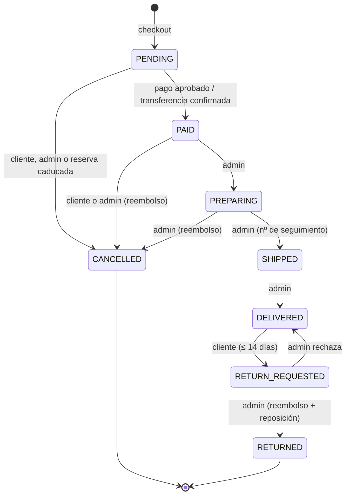

# Documentación funcional

Describe **qué hace** la tienda y con qué reglas, para poder diseñar casos de prueba sin leer el código. Las reglas se aplican **siempre en el backend**; el frontend solo las refleja.

## 1. Roles y permisos

| Capacidad | Invitado | Cliente (CUSTOMER) | Administrador (ADMIN) |
|---|:---:|:---:|:---:|
| Navegar catálogo, buscar, filtrar, ver fichas y reseñas | ✅ | ✅ | ✅ |
| Carrito (persistido con token de invitado) | ✅ | ✅ (persistente por usuario) | ✅ |
| Aplicar cupones | ❌ (`COUPON_REQUIRES_LOGIN`) | ✅ | ✅ |
| Checkout, pedidos, pagos | ❌ (redirige a login) | ✅ (solo los suyos) | ✅ (como cliente) |
| Perfil, direcciones, contraseña, sesiones | ❌ | ✅ | ✅ |
| Favoritos y reseñas | ❌ | ✅ (editar/borrar solo las propias) | ✅ (puede borrar cualquier reseña) |
| Panel de administración (`/admin`, `/api/admin/*`) | ❌ 401 | ❌ 403 | ✅ |
| Cambiar su propio rol/estado | — | — | ❌ (`CANNOT_MODIFY_OWN_ACCOUNT`) |

Un usuario **desactivado** no puede iniciar sesión (`403 ACCOUNT_DISABLED`) y sus sesiones abiertas dejan de funcionar al instante.

## 2. Cuenta y autenticación

- **Registro**: nombre (2-50), apellidos (2-80), email válido y único (se guarda en minúsculas), contraseña con política, teléfono español opcional, aceptación de términos obligatoria. Inicia sesión automáticamente y envía un email de bienvenida. No requiere verificación.
- **Política de contraseñas**: 8-64 caracteres, al menos una minúscula, una mayúscula y un número.
- **Login**: credenciales incorrectas o usuario inexistente → mismo error `401 INVALID_CREDENTIALS` (no se revela qué falla). **No hay bloqueo por intentos fallidos** ni CAPTCHA.
- **Sesiones**: cada login crea una sesión (máx. 7 días). Access token de 15 minutos renovable con el refresh token. El usuario puede ver sus sesiones, cerrar una concreta o todas las demás.
- **Cambio de contraseña**: exige la actual (`CURRENT_PASSWORD_INCORRECT`), la nueva debe ser distinta (`PASSWORD_REUSED`); cierra el resto de sesiones.
- **Recuperación**: `forgot-password` responde siempre igual (202). Si la cuenta existe se envía un enlace con token **de un solo uso** que caduca a los 30 minutos (`RESET_TOKEN_INVALID` / `RESET_TOKEN_EXPIRED` / `RESET_TOKEN_USED`). Restablecer la contraseña cierra todas las sesiones.
- **Perfil**: nombre, apellidos, teléfono y preferencia de marketing. El email no se puede cambiar.

## 3. Direcciones

- Máximo 10 por usuario (`ADDRESS_LIMIT_REACHED`). Solo España (`country = ES`).
- Validaciones: destinatario (3-100), teléfono español (`6/7/8/9` + 8 dígitos, prefijo +34 opcional), dirección (5-120), ciudad, **provincia de la lista oficial**, código postal `01000`-`52999`.
- La primera dirección es la predeterminada automáticamente. Solo hay una predeterminada. No se puede "desmarcar" la predeterminada sin elegir otra. Al borrar la predeterminada, la más antigua de las restantes pasa a serlo.
- Las direcciones de otros usuarios son invisibles (`404`).
- Los pedidos guardan una **copia** de la dirección: editarla o borrarla después no altera pedidos existentes.

## 4. Catálogo

- Solo los productos **activos** aparecen en listados, búsqueda y home. Un producto descatalogado sigue accesible por URL (disponibilidad `DISCONTINUED`) pero no se puede comprar.
- **Disponibilidad**: `IN_STOCK` (>5), `LOW_STOCK` (1-5, "Últimas unidades"), `OUT_OF_STOCK` (0), `DISCONTINUED`.
- **Descuento**: si hay precio anterior mayor que el actual, `discountPercent = round((1 - precio/anterior) × 100)`.
- **Novedad**: creado hace menos de 30 días.
- **Búsqueda**: insensible a mayúsculas y tildes; todas las palabras deben aparecer en nombre, marca, categoría o SKU (`portatil asus` encuentra los portátiles ASUS y también el monitor *ASUS ZenScreen MB166C 15,6" portátil*; `macbook` encuentra los dos MacBook).
- **Filtros combinables**: categoría (las padre incluyen subcategorías), marcas (varias), rango de precio, solo en stock, solo ofertas, valoración mínima, destacados. Rango de precio inválido (mín > máx) → `400`.
- **Ordenación**: relevancia (destacados y más vendidos), precio ↑/↓, popularidad (ventas), valoración, novedades, mayor descuento, nombre. Siempre con desempate determinista.
- **Facetas**: marcas con recuento (calculadas sin el propio filtro de marca), categorías, rango de precios, nº en stock y nº en oferta.
- **Valoración media**: se recalcula en cada alta/edición/baja de reseña.
- **Popularidad**: `salesCount` aumenta cuando un pedido se paga y disminuye si se cancela o devuelve.

## 5. Carrito

- Persistente: por usuario (en BD) o de invitado (token). Al iniciar sesión, el carrito de invitado se **fusiona** con el del usuario (cantidades sumadas y limitadas por stock y máximo por producto; productos no disponibles descartados).
- Cantidad por producto: 1-10 (`MAX_QUANTITY_EXCEEDED`). La cantidad 0 no es válida (`400`): para quitar un producto se elimina la línea. Máximo 50 productos distintos.
- Añadir: producto inexistente → `404 PRODUCT_NOT_FOUND`; descatalogado → `422 PRODUCT_UNAVAILABLE`; agotado → `409 OUT_OF_STOCK`; cantidad total > stock → `409 INSUFFICIENT_STOCK` (`details.availableStock`).
- El carrito muestra **incidencias** por línea cuando cambian las condiciones después de añadir: `UNAVAILABLE`, `OUT_OF_STOCK`, `INSUFFICIENT_STOCK`; y avisa de **cambios de precio** (`priceChanged`, precio anterior).
- **Totales calculados en el servidor** con precios actuales; las líneas con incidencias no suman. `hasIssues = true` bloquea el checkout.
- El envío mostrado es una estimación del envío estándar; el definitivo depende del método elegido.

## 6. Cupones

Validación, en este orden (todas `422` con su código):

1. Existe (`COUPON_INVALID`) · 2. Activo (`COUPON_INACTIVE`) · 3. Ha empezado (`COUPON_NOT_STARTED`) · 4. No ha caducado (`COUPON_EXPIRED`) · 5. No ha agotado sus usos globales (`COUPON_USAGE_LIMIT_REACHED`) · 6. Usuario autenticado (`COUPON_REQUIRES_LOGIN`) · 7. El usuario no ha superado sus usos (`COUPON_ALREADY_USED`) · 8. Subtotal mínimo (`COUPON_MIN_SUBTOTAL_NOT_REACHED`, con `missingCents`) · 9. Aplicable a algún producto si está restringido a categoría (`COUPON_NOT_APPLICABLE`).

- Tipos: porcentaje (sobre los productos elegibles, con tope opcional), importe fijo (nunca supera el subtotal elegible) y envío gratis.
- Un solo cupón por carrito. Si un cupón aplicado deja de ser válido (por ejemplo, al bajar el subtotal) el carrito lo conserva con `couponError` y **no aplica el descuento**; el checkout falla hasta quitarlo.
- Al confirmar el pedido se registra el uso (con control atómico del límite global). Cancelar un pedido **libera** el uso del cupón.

## 7. Envío y totales

- `STANDARD` 4,99 € (gratis desde 99 €), `EXPRESS` 12,99 €, `PICKUP` 1,99 € (gratis desde 49 €, requiere punto de recogida: `PICKUP_POINT_REQUIRED`).
- El umbral de envío gratis se evalúa sobre el **subtotal tras descuentos**.
- Total = subtotal − descuento + envío. Precios con IVA (21 %) incluido; `taxCents` informa del IVA contenido.

## 8. Checkout

Pasos en la UI: dirección → envío → pago → revisión → confirmación. En la API, `POST /api/checkout/quote` calcula el presupuesto y `POST /api/orders` confirma.

Al confirmar, en **una única transacción**:

1. Se bloquea el carrito del usuario (dos checkouts simultáneos del mismo usuario se serializan: el segundo encuentra el carrito vacío → `CART_EMPTY`).
2. Se valida que todas las líneas son comprables (`CART_HAS_ISSUES` con el detalle).
3. Se validan dirección (`ADDRESS_NOT_FOUND`), método de envío, punto de recogida y cupón.
4. Se calculan los importes en el servidor. Si el cliente envía `expectedTotalCents` y no coincide → `409 PRICE_CHANGED`.
5. Se descuenta el stock de forma **atómica y condicional** (nunca negativo; si otro cliente compró la última unidad → `409 INSUFFICIENT_STOCK`).
6. Se crea el pedido con copia de precios, productos y dirección; se registra el cupón y se vacía el carrito.

Después se procesa el pago (sección 9). **Idempotencia**: con `Idempotency-Key`, repetir la misma petición devuelve el pedido original (`200` + `Idempotent-Replayed`) y reutilizar la clave con otro cuerpo → `422 IDEMPOTENCY_KEY_REUSED`. El botón de confirmar se deshabilita mientras se procesa.

## 9. Pagos

- **Tarjeta**: solo tarjetas de prueba documentadas (`CARD_NOT_ALLOWED` para cualquier otra). Se valida formato, Luhn y caducidad. Solo se guardan marca y últimos 4 dígitos.
- **Transferencia**: el pedido queda reservado 72 h con una referencia; un administrador confirma la recepción.
- Un pedido admite un solo pago en curso (`PAYMENT_IN_PROGRESS`). Si falla, puede reintentarse (también con otro método) mientras el pedido siga `PENDING` y la reserva esté vigente (`ORDER_NOT_PAYABLE` si no).
- Reserva de stock: 30 minutos para tarjeta. Al caducar sin pago, el pedido se **cancela automáticamente** y el stock se libera.
- Estado de pago del pedido: `AWAITING_PAYMENT`, `PROCESSING`, `PAID`, `FAILED`, `REFUNDED`. Cada intento queda registrado (`PENDING`, `APPROVED`, `DECLINED`, `FAILED`, `REFUNDED`).

## 10. Pedidos: estados y transiciones

| Transición | Quién | Efectos |
|---|---|---|
| → PAID | Sistema (pago) / Admin (`confirm-payment`) | `paidAt`, ventas +, email de confirmación. El endpoint genérico de estado **no** permite pasar a PAID |
| → PREPARING / SHIPPED / DELIVERED | Admin | Fechas, nº de seguimiento (generado si no se indica), emails |
| → CANCELLED | Cliente (PENDING/PAID), Admin (PENDING/PAID/PREPARING), Sistema | Repone stock, reembolsa si estaba pagado, libera el cupón, ventas −. No permitido con un pago en curso |
| → RETURN_REQUESTED | Cliente, dentro de 14 días desde la entrega (`RETURN_WINDOW_EXPIRED`) | Motivo obligatorio (≥ 5 caracteres) |
| → RETURNED | Admin | Repone stock, reembolsa, ventas − |

Cualquier otra transición → `409 INVALID_STATUS_TRANSITION` (`details.allowed` indica las posibles); un pedido cancelado nunca puede enviarse. Las transiciones usan control optimista: si dos personas cambian el mismo pedido a la vez, una recibe `409 CONFLICT`. Cada cambio queda en el historial con fecha, actor y nota.

## 11. Favoritos y reseñas

- Favoritos: añadir (`409 FAVORITE_ALREADY_EXISTS` si ya está), quitar (`404 FAVORITE_NOT_FOUND` si no está), listar. Persistentes por usuario; admiten productos agotados o descatalogados.
- Reseñas: una por usuario y producto (`409 REVIEW_ALREADY_EXISTS`); valoración entera 1-5, título 3-120, comentario 10-2000. Solo el autor edita; autor o admin borran. "Compra verificada" si el usuario recibió el producto. Listado paginado con orden y filtro por estrellas y resumen con distribución.

## 12. Administración

- **Dashboard**: usuarios, productos, pedidos, ventas (pedidos pagados o posteriores no cancelados/devueltos), ticket medio, pendientes de pago, por enviar, devoluciones, sin stock, stock bajo, ventas de los últimos 14 días, pedidos recientes, alertas de stock y más vendidos.
- **Productos**: crear (SKU único `SKU_ALREADY_EXISTS`, solo en subcategorías `CATEGORY_NOT_ASSIGNABLE`, precio anterior mayor que el precio `INVALID_PRICE`), editar, activar/desactivar, cambiar precio y stock, ajuste atómico de stock (`+/-`, nunca negativo).
- **Pedidos**: filtros por estado, estado de pago, texto (nº de pedido o email) y fechas; detalle con transiciones permitidas; confirmar transferencias.
- **Usuarios**: búsqueda y filtros; activar/desactivar (revoca sesiones) y cambiar rol.
- **Cupones**: crear, editar, activar/desactivar, fechas de validez, mínimo, tope, categoría, límite global y por cliente. Estado calculado: activo, desactivado, programado, caducado, agotado.

## 13. Emails

Se generan emails reales (guardados en el buzón simulado) para: bienvenida, recuperación y cambio de contraseña, instrucciones de transferencia, pedido pagado, enviado, entregado, cancelado, devolución solicitada y devolución completada.
