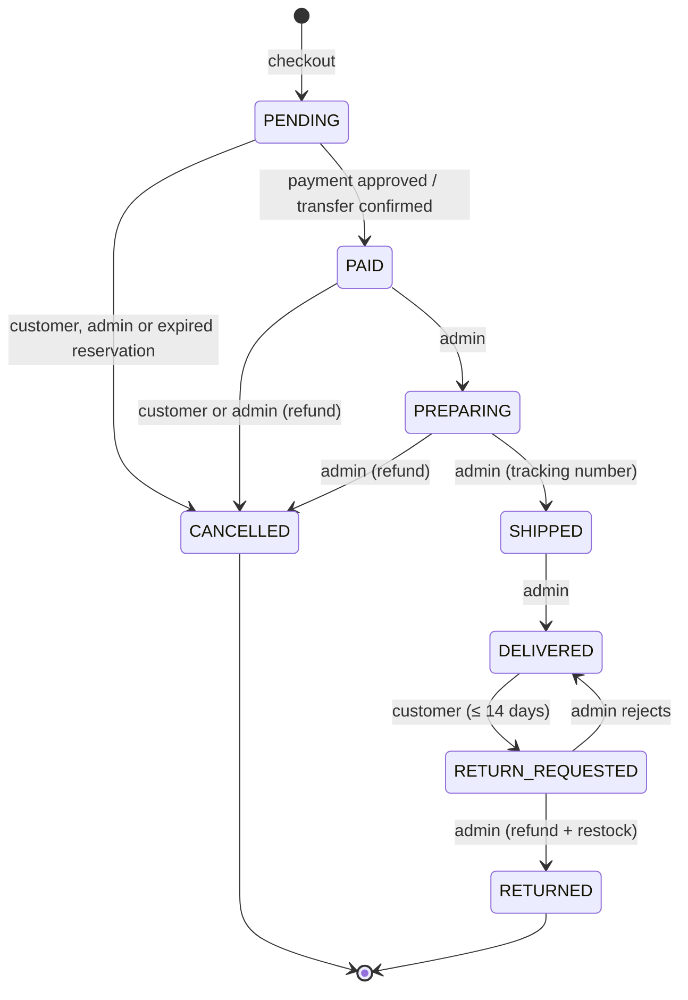

# Functional documentation

Describes **what** the store does and the rules it follows, so you can design test cases without reading the code. The rules are **always enforced by the backend**; the frontend only reflects them.

The UI is in English. The store sells in euros, prices include Spanish VAT (21%) and it only ships to Spain, so addresses, phone numbers and postal codes follow Spanish rules.

## 1. Roles and permissions

| Capability | Guest | Customer (CUSTOMER) | Administrator (ADMIN) |
|---|:---:|:---:|:---:|
| Browse the catalog, search, filter, view product pages and reviews | ✅ | ✅ | ✅ |
| Cart (persisted with a guest token) | ✅ | ✅ (persistent per user) | ✅ |
| Apply coupons | ❌ (`COUPON_REQUIRES_LOGIN`) | ✅ | ✅ |
| Checkout, orders, payments | ❌ (redirects to login) | ✅ (own orders only) | ✅ (as a customer) |
| Profile, addresses, password, sessions | ❌ | ✅ | ✅ |
| Favorites and reviews | ❌ | ✅ (edit/delete own reviews only) | ✅ (can delete any review) |
| Admin panel (`/admin`, `/api/admin/*`) | ❌ 401 | ❌ 403 | ✅ |
| Change their own role/status | — | — | ❌ (`CANNOT_MODIFY_OWN_ACCOUNT`) |

A **disabled** user cannot sign in (`403 ACCOUNT_DISABLED`) and their open sessions stop working immediately.

## 2. Account and authentication

- **Registration**: first name (2-50), last name (2-80), valid and unique e-mail (stored in lower case), password following the policy, optional Spanish phone number, mandatory acceptance of the terms. Signs the user in automatically and sends a welcome e-mail. No verification required.
- **Password policy**: 8-64 characters, at least one lowercase letter, one uppercase letter and one number.
- **Login**: wrong credentials or unknown user → the same `401 INVALID_CREDENTIALS` error (it does not reveal what failed). **There is no lockout after failed attempts** and no CAPTCHA.
- **Sessions**: every login creates a session (max. 7 days). 15-minute access token renewable with the refresh token. Users can list their sessions, sign out a specific one or all the others.
- **Password change**: requires the current password (`CURRENT_PASSWORD_INCORRECT`), the new one must be different (`PASSWORD_REUSED`); signs out the other sessions.
- **Recovery**: `forgot-password` always answers the same way (202). If the account exists, a link with a **single-use** token that expires after 30 minutes is sent (`RESET_TOKEN_INVALID` / `RESET_TOKEN_EXPIRED` / `RESET_TOKEN_USED`). Resetting the password signs out every session.
- **Profile**: first name, last name, phone and marketing preference. The e-mail cannot be changed.

## 3. Addresses

- At most 10 per user (`ADDRESS_LIMIT_REACHED`). Spain only (`country = ES`).
- Validation: recipient (3-100), Spanish phone (`6/7/8/9` + 8 digits, optional +34 prefix), address (5-120), city, **province from the official list**, postal code `01000`-`52999`.
- The first address automatically becomes the default. There is only one default. The default cannot be "unset" without choosing another one. When the default is deleted, the oldest remaining address becomes the default.
- Other users' addresses are invisible (`404`).
- Orders store a **copy** of the address: editing or deleting it later does not change existing orders.

## 4. Catalog

- Only **active** products appear in listings, search and the home page. A discontinued product is still reachable by URL (availability `DISCONTINUED`) but cannot be bought.
- **Availability**: `IN_STOCK` (>5), `LOW_STOCK` (1-5, "Low stock" / "Only N left"), `OUT_OF_STOCK` (0), `DISCONTINUED`.
- **Discount**: when the compare-at price is greater than the current price, `discountPercent = round((1 - price/compareAt) × 100)`.
- **New**: created less than 30 days ago.
- **Search**: case- and accent-insensitive; every word must appear in the name, brand, category or SKU (`laptop asus` finds the two ASUS laptops; `macbook` finds both MacBooks).
- **Combinable filters**: category (parent categories include their subcategories), brands (several), price range, in stock only, on sale only, minimum rating, featured. Invalid price range (min > max) → `400`.
- **Sorting**: relevance (featured and best sellers), price ↑/↓, popularity (sales), rating, newest, biggest discount, name. Always with a deterministic tie-breaker.
- **Facets**: brands with counts (computed without the brand filter itself), categories, price range, number in stock and number on sale.
- **Average rating**: recomputed whenever a review is created, edited or deleted.
- **Popularity**: `salesCount` increases when an order is paid and decreases if it is cancelled or returned.

## 5. Cart

- Persistent: per user (in the database) or guest (token). On sign-in, the guest cart is **merged** into the user cart (quantities added and capped by stock and the per-product maximum; unavailable products discarded).
- Quantity per product: 1-10 (`MAX_QUANTITY_EXCEEDED`). Quantity 0 is not valid (`400`): to remove a product, delete the line. At most 50 different products.
- Adding: unknown product → `404 PRODUCT_NOT_FOUND`; discontinued → `422 PRODUCT_UNAVAILABLE`; out of stock → `409 OUT_OF_STOCK`; total quantity > stock → `409 INSUFFICIENT_STOCK` (`details.availableStock`).
- The cart shows per-line **issues** when conditions change after adding: `UNAVAILABLE`, `OUT_OF_STOCK`, `INSUFFICIENT_STOCK`; and warns about **price changes** (`priceChanged`, previous price).
- **Totals computed on the server** with current prices; lines with issues do not count. `hasIssues = true` blocks the checkout.
- The shipping shown is an estimate of standard shipping; the final cost depends on the method chosen.

## 6. Coupons

Validation, in this order (all `422` with their code):

1. Exists (`COUPON_INVALID`) · 2. Active (`COUPON_INACTIVE`) · 3. Has started (`COUPON_NOT_STARTED`) · 4. Has not expired (`COUPON_EXPIRED`) · 5. Has not used up its global uses (`COUPON_USAGE_LIMIT_REACHED`) · 6. Authenticated user (`COUPON_REQUIRES_LOGIN`) · 7. The user has not exceeded their uses (`COUPON_ALREADY_USED`) · 8. Minimum subtotal (`COUPON_MIN_SUBTOTAL_NOT_REACHED`, with `missingCents`) · 9. Applies to some product if restricted to a category (`COUPON_NOT_APPLICABLE`).

- Types: percentage (on eligible products, with an optional cap), fixed amount (never exceeds the eligible subtotal) and free shipping.
- One coupon per cart. If an applied coupon stops being valid (for example, when the subtotal drops) the cart keeps it with `couponError` and **does not apply the discount**; the checkout fails until it is removed.
- Confirming the order records the use (with an atomic check of the global limit). Cancelling an order **releases** the coupon use.

## 7. Shipping and totals

- `STANDARD` €4.99 (free over €99), `EXPRESS` €12.99, `PICKUP` €1.99 (free over €49, requires a pickup point: `PICKUP_POINT_REQUIRED`).
- The free-shipping threshold is evaluated on the **subtotal after discounts**.
- Total = subtotal − discount + shipping. Prices include VAT (21%); `taxCents` reports the VAT included.

## 8. Checkout

Steps in the UI: address → shipping → payment → review → confirmation. In the API, `POST /api/checkout/quote` computes the quote and `POST /api/orders` confirms.

On confirmation, in **a single transaction**:

1. The user cart is locked (two simultaneous checkouts by the same user are serialised: the second one finds the cart empty → `CART_EMPTY`).
2. Every line is checked to be purchasable (`CART_HAS_ISSUES` with the details).
3. Address (`ADDRESS_NOT_FOUND`), shipping method, pickup point and coupon are validated.
4. Amounts are computed on the server. If the client sends `expectedTotalCents` and it does not match → `409 PRICE_CHANGED`.
5. Stock is decremented **atomically and conditionally** (never negative; if another customer bought the last unit → `409 INSUFFICIENT_STOCK`).
6. The order is created with a copy of prices, products and address; the coupon use is recorded and the cart emptied.

The payment is processed afterwards (section 9). **Idempotency**: with `Idempotency-Key`, repeating the same request returns the original order (`200` + `Idempotent-Replayed`) and reusing the key with a different body → `422 IDEMPOTENCY_KEY_REUSED`. The confirm button is disabled while processing.

## 9. Payments

- **Card**: only the documented test cards (`CARD_NOT_ALLOWED` for any other). Format, Luhn and expiry are validated. Only the brand and the last 4 digits are stored.
- **Bank transfer**: the order is reserved for 72 h with a reference; an administrator confirms receipt.
- An order allows only one payment in progress (`PAYMENT_IN_PROGRESS`). If it fails, it can be retried (also with another method) while the order is still `PENDING` and the reservation is valid (`ORDER_NOT_PAYABLE` otherwise).
- Stock reservation: 30 minutes for cards. When it expires without payment, the order is **cancelled automatically** and the stock released.
- Order payment status: `AWAITING_PAYMENT`, `PROCESSING`, `PAID`, `FAILED`, `REFUNDED`. Every attempt is recorded (`PENDING`, `APPROVED`, `DECLINED`, `FAILED`, `REFUNDED`).

## 10. Orders: statuses and transitions

| Transition | Who | Effects |
|---|---|---|
| → PAID | System (payment) / Admin (`confirm-payment`) | `paidAt`, sales +, confirmation e-mail. The generic status endpoint does **not** allow moving to PAID |
| → PREPARING / SHIPPED / DELIVERED | Admin | Dates, tracking number (generated if not provided), e-mails |
| → CANCELLED | Customer (PENDING/PAID), Admin (PENDING/PAID/PREPARING), System | Restocks, refunds if paid, releases the coupon, sales −. Not allowed while a payment is in progress |
| → RETURN_REQUESTED | Customer, within 14 days of delivery (`RETURN_WINDOW_EXPIRED`) | Mandatory reason (≥ 5 characters) |
| → RETURNED | Admin | Restocks, refunds, sales − |

Any other transition → `409 INVALID_STATUS_TRANSITION` (`details.allowed` lists the possible ones); a cancelled order can never be shipped. Transitions use optimistic locking: if two people change the same order at once, one of them gets `409 CONFLICT`. Every change is recorded in the history with date, actor and note.

## 11. Favorites and reviews

- Favorites: add (`409 FAVORITE_ALREADY_EXISTS` if already there), remove (`404 FAVORITE_NOT_FOUND` if not there), list. Persistent per user; out-of-stock and discontinued products are allowed.
- Reviews: one per user and product (`409 REVIEW_ALREADY_EXISTS`); integer rating 1-5, title 3-120, comment 10-2000. Only the author edits; the author or an admin deletes. "Verified purchase" if the user received the product. Paginated list with sorting, star filter and a summary with the distribution.

## 12. Administration

- **Dashboard**: users, products, orders, sales (paid or later orders that are not cancelled/returned), average order value, awaiting payment, to ship, returns, out of stock, low stock, sales in the last 14 days, recent orders, stock alerts and best sellers.
- **Products**: create (unique SKU `SKU_ALREADY_EXISTS`, only in leaf categories `CATEGORY_NOT_ASSIGNABLE`, compare-at price greater than the price `INVALID_PRICE`), edit, enable/disable, change price and stock, atomic stock adjustment (`+/-`, never negative).
- **Orders**: filters by status, payment status, text (order number or e-mail) and dates; detail with the allowed transitions; confirm bank transfers.
- **Users**: search and filters; enable/disable (revokes sessions) and change role.
- **Coupons**: create, edit, activate/deactivate, validity dates, minimum, cap, category, global and per-customer limits. Computed state: active, deactivated, scheduled, expired, used up.

## 13. E-mails

Real e-mails (stored in the simulated mailbox) are generated for: welcome, password recovery and change, bank transfer instructions, order paid, shipped, delivered, cancelled, return requested and return completed.
